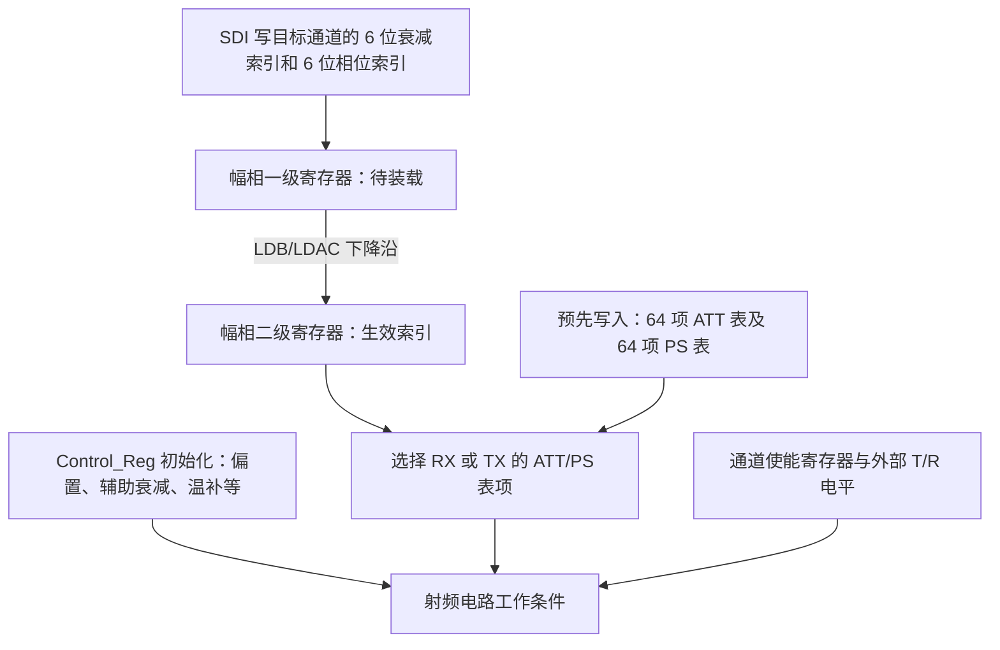

# CCAR10405L 幅相工作逻辑与寄存器链

依据目录 `D:/beam_control/软件/软件/芯片资料` 中的 CCAR10405L 数据手册 V1.0、TandR_SPI_datasheet_CCARX01 及 CCAR10405L 详测码表 202609。DXF 用于板上器件/RF 位置映射，不用于推定片内寄存器语义。本文区分厂家明确给出的逻辑与资料尚未说明的模拟电路细节。

## 1. 幅相如何生效

芯片包含四个收发共用 RF 通道和一个 COM 口。接收与发射分别有幅相控制数据。每次动态配置发的是两个 6 位索引：衰减索引 A、相位索引 P。内部按索引选择预先写好的 RXATT/TXATT 与 RXPS/TXPS 表项，把 10 位衰减控制字、16 位移相控制字送给射频电路。

依据 SPI 第 5、7、8、10～14 页：SYNC 拉高后的 SCLK 完成寄存器处理；LDB 装载幅相一级寄存器到二级寄存器。第 8 页框图由二级数据驱动查表选择。LDB 控制的是幅相装载；通道开关由通道使能及 T/R 组合控制。因此通道开关生效不证明幅相二级寄存器已更新。

## 2. 七类相关寄存器与地址空间

下表“功能码”指芯片 SPI 的 D18～D16，另有 D19 读写位（写 0、读 1）和 D23～D20 CID。它不是上位机 UART 命令号，例如 UART `40` 与芯片功能 `100` 不是同一个字段。

| 对象 | 功能码 | 地址/选择字段 | 数据 | 使用时机 |
| --- | --- | --- | --- | --- |
| 通道使能 Reg_Channel_Ena | 000 | 无独立地址 | 16 位掩码，本芯片用低 4 位对应 RF1～4 | 开关通道 |
| TX 幅相一级寄存器 | 001 | D15～D12 为通道，当前用 0～3 | D11～D6 衰减索引，D5～D0 相位索引 | 每次调整发射幅相 |
| RX 幅相一级寄存器 | 010 | 同上 | 同上 | 每次调整接收幅相 |
| Control_Reg | 100 | 8 位地址 | 8 位控制字 | 上电/复位后初始化偏置等 |
| PS 查表寄存器 | 101 | TX 地址 0～127；RX 地址 128～255 | 每帧 8 位，每表项分高/低两个字节 | 初始化或重写移相表 |
| TXATT 查表寄存器 | 110 | 6 位地址 0～63 | 10 位控制字 | 初始化或重写发射衰减表 |
| RXATT 查表寄存器 | 111 | 6 位地址 0～63 | 10 位控制字 | 初始化或重写接收衰减表 |

幅相二级寄存器由 LDB 装载，资料没有给出独立写它的 SPI 功能码。功能 011 是信号/ADC 读取路径，不是幅相配置步骤。

**地址属于不同空间。** `REG_CONTROL_31`、`RXATT[31]` 与“动态衰减索引 31”分别是控制寄存器、查表存储单元、选表索引，不能互换。

## 3. 厂家表里的普通控制寄存器

以下地址均为十进制，值为十六进制；按用户指定采用 Control_Reg 的 E 列。完整 128 项、原信号名、E/F 冲突及来源单元格另存 `CCAR10405L_控制寄存器E列明细_20261030.csv`。

| 内容 | RF1 | RF2 | RF3 | RF4 | E 列值 |
| --- | --- | --- | --- | --- | --- |
| TX PA1 的 cs/cg1/cg2/cg3 | 0～3 | 20～23 | 40～43 | 60～63 | 各 04 |
| TX PA2 的 cs/cg1/cg2/cg3 | 4～7 | 24～27 | 44～47 | 64～67 | 各 04 |
| RX LNA 的 stg12_vgm/stg3_vgm/stg3_vcas1 | 8～10 | 28～30 | 48～50 | 68～70 | 各 04 |
| `dig1p8_rxatt1_sel_cN[4:0]` | 11 | 31 | 51 | 71 | 各 00 |
| `dig1p8_txatt2_sel_cN[4:0]` | 12 | 32 | 52 | 72 | 各 08 |
| 表中 Null 预留项 | 13～19 | 33～39 | 53～59 | 73～79 | 各 00 |

`rxatt1_sel`、`txatt2_sel` 是普通控制寄存器中的 5 位字段；RXATT/TXATT 表中的 `dig_1p8_rxatt_sel[7:0]`、`dig_1p8_txatt_sel[7:0]` 是另一组字段。现有资料没有说明两者在模拟电路中的串接关系、覆盖选择关系或各码的精确衰减量，不能把前者解释为“幅相旁路开关”，也不能用它们替代 6 位动态幅相索引。它们应按厂家初始化值先设好。

| 公共控制地址（十进制） | 厂家信号/用途 | E 列值 |
| --- | --- | --- |
| 80～85 | TX/RX/COM 的 `tcatt_*_p/n_trim` | 各 01 |
| 86～89 | TX PA2/PA1/DA2/DA1 的 `pmu_sl_*` | 02、02、01、01 |
| 90、91 | TX/RX 的 `pmu_sl_tcatt_*` | 03、03 |
| 92～94 | RX LNA/DA2/DA1 的 `pmu_sl_*` | 02、01、01 |
| 95～97 | exp_lt、exp_ht、com 的 `pmu_sl_*` | 00、00、02 |
| 98～101 | LDO、基准电流、温度电流 trim | 各 0F |
| 102～108 | TX/RX 各放大级的 `pmu_dac_*` | 各 0F |
| 109 | exp DAC | 00 |
| 110～115 | 芯片/通道/PMU 测试选择 | 各 00 |
| 116 | `d2d_en_adc,d2d_ctr_clk_adc` | 00 |
| 117～127 | 未给信号名的项 | 各 00 |

上述偏置/温补用途根据手册描述及表中信号名归类；表中未提供每位的完整模拟传递函数。尤其 12/32/52/72、102/103/107/108/116 等地址存在 E/F 不一致，本项目继续按 E 列，不混用 F 列值。

## 4. 幅相表怎样与动态索引衔接

厂家 RXATT 与 TXATT 各有 64 项；高两位为未用位，低八位为射频衰减控制字。当前表每项为 `index << 2`。RXPS 与 TXPS 各有 64 项，每项 16 位，当前表为 `index << 6`。

| 动态索引 | ATT 表值（10 位） | 标称衰减 | PS 表值（16 位） | 标称相移 |
| --- | --- | --- | --- | --- |
| 00 | 000 | 0 dB | 0000 | 0° |
| 01 | 004 | 0.5 dB | 0040 | 5.625° |
| 0A | 028 | 5 dB | 0280 | 56.25° |
| 1F | 07C | 15.5 dB | 07C0 | 174.375° |
| 20 | 080 | 16 dB | 0800 | 180° |
| 3F | 0FC | 31.5 dB | 0FC0 | 354.375° |

标称步进依据本型号手册第 3、4 页；实际误差需 RF 实测。ATT 表项的 0x07C 不是直接塞入动态幅相帧的 6 位字段：动态字段仍写索引 0x1F。

PS 状态 k 的 TX 高/低字节地址为 2k、2k+1；RX 为 128+2k、129+2k。表项是每颗芯片内供各通道按各自索引选择的表，通道字段不出现在 ATT/PS 表写入帧中；动态幅相帧才指定 RF 通道。

## 5. J1 / 芯片 3 / RF1 接收衰减示例

CID=3，芯内 RF1 对应通道选择 0。完整初始化先写控制/移相/衰减表，不仅写下面几个示例项。

| 操作 | 芯片 24 位 SPI 帧 | 含义 |
| --- | --- | --- |
| 控制寄存器 11 = 00 | 340B00 | RF1 的 rxatt1_sel 厂家默认值 |
| RXATT 索引 0 = 000 | 370000 | 建立 0 dB 表项 |
| RXATT 索引 31 = 07C | 377C7C | 建立索引 31 的衰减控制字 |
| RXPS 状态 0 高字节 | 358000 | RXPS 地址 128 = 00 |
| RXPS 状态 0 低字节 | 358100 | RXPS 地址 129 = 00 |
| 仅打开 RF1 | 300001 | 通道使能掩码 0001；会关闭该芯片其他 RF 通道 |
| RF1 RX 衰减 0，相位 0 | 320000 | 写待装载索引 A=0、P=0 |
| RF1 RX 衰减 31，相位 0 | 3207C0 | 写待装载索引 A=31、P=0 |

最后两个动态帧分别是两次试验的目标值。每次帧完成后满足 SYNC/SCLK 间隔，再发 LDB 下降沿把目标幅相装载生效。接收状态还要求 T=0、R=1、RF1 使能位为 1。SDO 只用于读回核验，未参与幅相写入的必要触发链。

## 6. 与当前 V0.3 的对应及未闭合点

- `beam_ctrl_core.sv`：上电/线阵复位后按 V2.1 第 30 页所列顺序写 128 个控制字、TXPS 128 字节、TXATT 64 项、RXPS 128 字节、RXATT 64 项，共 512 帧；不额外写固定全关帧。通道开关由随后的目标控制命令写入。
- `channel_executor.sv`：UART 40 解码后，写通道使能帧，再写目标 RX/TX 幅相索引帧，随后发 LDB；当前 40 不重写整套查表寄存器。
- `array_write_engine.sv`：帧结束、CSB 高期间补两个 SCLK 上升沿。
- `array_load_ctrl.sv`：产生低有效 LDB；当前低脉宽 100 ns。帧后等待要求已在 ILA 中验证，但厂家未明确给出最小低脉宽，芯片端实际装载仍未证明。
- 初始化值与 XLSX 逐项比较无差异；SDO 当前不能可靠回读，所以“源码/发送正确”尚未闭合为“片内表正确”。

## 7. 必须标明的资料矛盾

1. SPI 第 10 页表格和正文均规定 TX 功能 001、RX 功能 010；第 11 页上图中文写“发射/010”却输出 RXATT/RXPS，下图中文写“接收/001”却输出 TXATT/TXPS。当前 RTL 按第 10 页及图中 RX/TX 输出名称一致的映射执行。不能仅据第 11 页中文标题翻转功能码；厂家确认或受控收发寄存器试验可消除最终歧义。
2. 通用 SPI 文档描述 16 通道、256 个控制寄存器；CCAR10405L 是 4 通道，厂家控制表仅给出地址 0～127。
3. 本型号手册写 RSTN 为异步复位；通用 SPI 文档要求低电平覆盖 128 个时钟。当前实现采用后者的复位序列，但不能据通用文档臆造未列出的本型号管脚或寄存器。
4. 厂家码表部分 E 单元格写作 `2'b` 后跟 8 位数，这是表中文字格式；软件解析实际 8 位数据，遵循用户确定的 E 列。

本次为资料和实现梳理，未发送硬件命令，也未修改 RTL 或下载 BIT。
