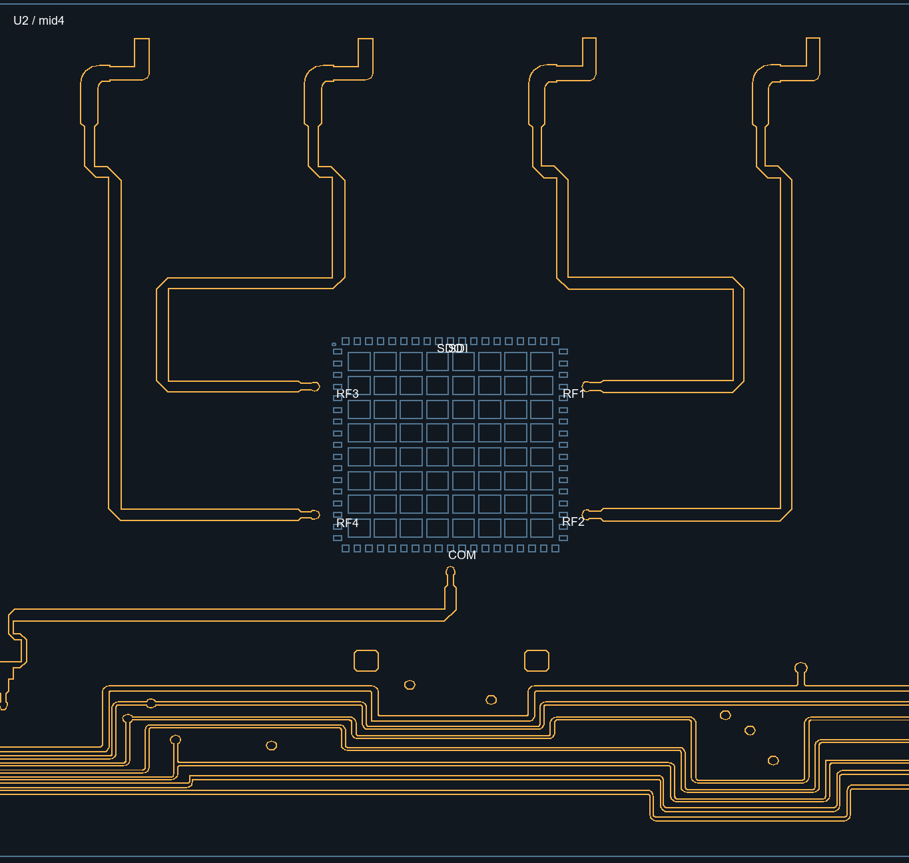

# V0.3 物理映射：DXF 馈线核对结果

此前仅检查 PIN_TOP 焊盘标注，遗漏 mid4 层的射频馈线，导致错误地将 RF 口到阵元顺序列为待确认。本次已沿 top 层焊盘短线、同坐标过孔和 mid4 层馈线追到上缘的四个阵元馈点，四颗芯片排列一致。

## 确定的映射

- 用户确认：接收 J1～J8 分别是线阵 0～7。
- 视角以用户实板照片为基准：阵元在上方、数字连接器在右侧，芯片 0 在最右端；从左到右逻辑芯片为 3、2、1、0。
- `BJN122-RF-TR(1).dxf` 的 mid4 馈线从左到右为 RF4、RF3、RF1、RF2。top 层分别接到 RF 焊盘旁过孔，mid4 层向上接至阵元馈点。
- 芯片手册第 6 页表 7 明列 RF1～RF4 为通道 1～4；程序通道索引 0～3 对应 RF1～RF4。
- SDI1～4 对应逻辑芯片 0～3；CID 沿用 V0.2 验证的 `16'h3210`，即逻辑芯片 0～3 的发送 CID 为 0～3。芯片 U 位号不作为控制寻址输入。
- 9.6 mm 间距来自用户确认。以线阵中心为 X=0，照片向右为 +X。

上述图由原 DXF 图元直接绘制，黄色为 mid4，蓝色为 PIN_TOP 焊盘。RF4 走至最左端，RF3 至左二，RF1 至右二，RF2 至最右端。整线图见 `RF通道馈线_整线_mid4.png`；U1 的 PIN_TOP 文字在 DXF 中缺失，其四条馈线形状、芯片朝向及位置与其他三个单元一致。

## 每条线阵的 16 阵元

按照片视角从左到右，坐标单位 mm。程序通道采用 0 起始编号。

| 左起阵元 | 逻辑芯片 | SDI | CID | RF | 程序通道 | X |
| ---: | ---: | --- | ---: | --- | ---: | ---: |
| 1 | 3 | SDI4 | 3 | RF4 | 3 | -72.0 |
| 2 | 3 | SDI4 | 3 | RF3 | 2 | -62.4 |
| 3 | 3 | SDI4 | 3 | RF1 | 0 | -52.8 |
| 4 | 3 | SDI4 | 3 | RF2 | 1 | -43.2 |
| 5 | 2 | SDI3 | 2 | RF4 | 3 | -33.6 |
| 6 | 2 | SDI3 | 2 | RF3 | 2 | -24.0 |
| 7 | 2 | SDI3 | 2 | RF1 | 0 | -14.4 |
| 8 | 2 | SDI3 | 2 | RF2 | 1 | -4.8 |
| 9 | 1 | SDI2 | 1 | RF4 | 3 | 4.8 |
| 10 | 1 | SDI2 | 1 | RF3 | 2 | 14.4 |
| 11 | 1 | SDI2 | 1 | RF1 | 0 | 24.0 |
| 12 | 1 | SDI2 | 1 | RF2 | 1 | 33.6 |
| 13 | 0 | SDI1 | 0 | RF4 | 3 | 43.2 |
| 14 | 0 | SDI1 | 0 | RF3 | 2 | 52.8 |
| 15 | 0 | SDI1 | 0 | RF1 | 0 | 62.4 |
| 16 | 0 | SDI1 | 0 | RF2 | 1 | 72.0 |

完整表见 `V03阵面通道坐标映射_20261029.csv`，由 `scripts/generate_physical_mapping.py` 生成，共 256 行，收发各 128 通道。发射表采用同一 TR 板及照片视角的坐标约定；发射接口标号未在本轮声明，因此该列留空。Y 列明确标为线阵号坐标约定：Y=(线阵号-3.5)×9.6 mm；接口编号决定控制目标，整机上下安装方向未由单条线阵照片声明，不把该 Y 约定伪称为已测安装位置。

## RTL 与验证

`beam_phase_calc.sv` 已采用照片的芯片顺序和 DXF 的 RF 馈线顺序。通道 0/1/2/3 在芯片组内对应左起位置 2/3/1/0（位置从 0 编号）。单通道命令的寻址编号保持原有含义，更新的是 20/A0 给各通道使用的物理 X 坐标。

Vivado 2024.2 XSim 回归通过：`TB_V03_PASS`、`TB_BEAM_FORMULA_PASS`、`TB_PULSE_PASS`、`TB_U22_DEVICE_PASS`、`CCAR10405L_INIT_PASS`。20 命令在 16 GHz、方位 +30°、俯仰 +15° 下检查芯片 0 的四个通道码 59/44/11/27，并检查芯片 3 端点及实际 SPI 帧；A0 检查负方位时的选中通道码和使能位置。期望值由 DXF 坐标及原 Q20 三角表独立计算。

日志：`reports/rf_order_regression_20261029.log`。AMD ROSS 已读回同一会话的 Vivado 版本 2024.2；仿真使用工程现有 `scripts/run_sim.ps1` 调用 XSim。包含本次坐标修正的 BIT/MCS 已生成于 `output/release_20261029/`，详见其中的《固化与测试说明》。
